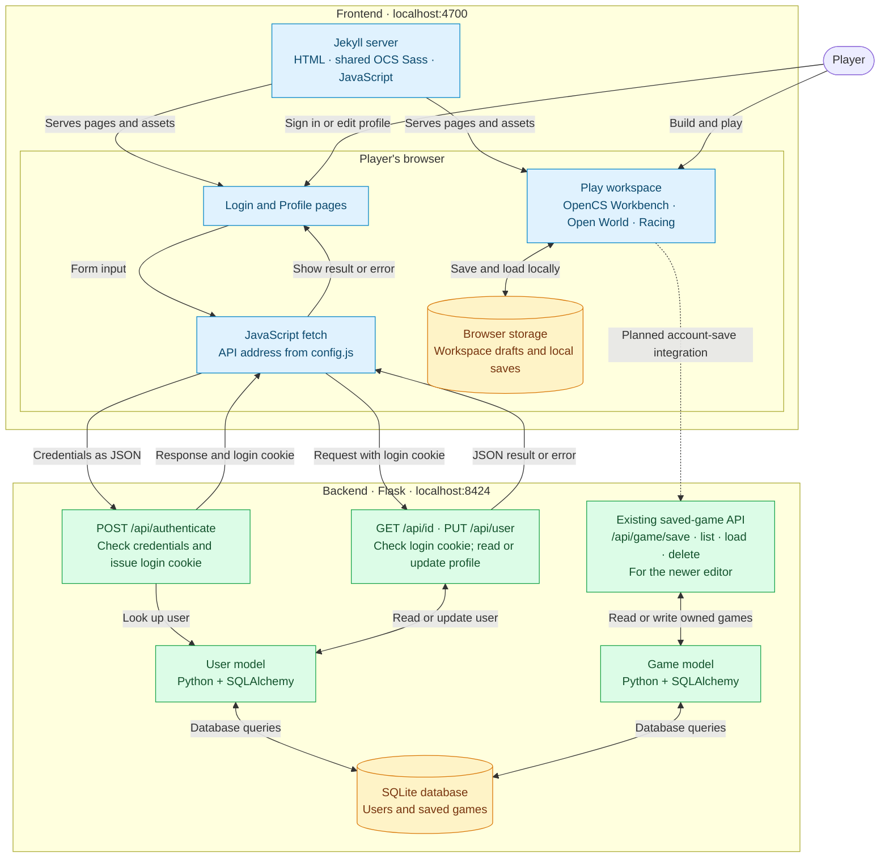

# GameMaker frontend and backend

Current localhost architecture. The frontend displays the interface; Flask checks requests and reads or updates the database.

**Solid arrows:** existing connections. **Dotted arrow:** planned integration. The inherited builders' account-save requests use `/api/gamebuilder`, which this backend does not implement; connecting them to `/api/game/*` requires adapting their save formats.

The default local database is `Backend/instance/volumes/user_management.db`. Browser saves stay on the current device and site address.

Source references: [frontend API configuration](../assets/js/api/config.js), [backend user API](../../Backend/api/user.py), [backend game API](../../Backend/api/game_api.py), and [localhost demo instructions](LOCAL_DEMO.md).
